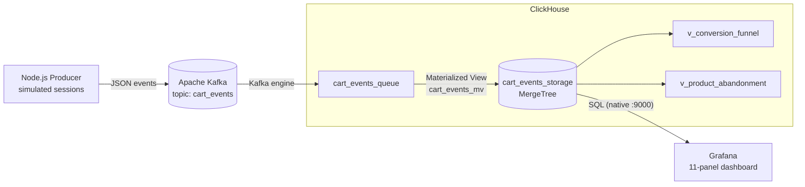

<div align="center">

# Real-time Cart Analytics

**An end-to-end streaming analytics pipeline for e-commerce shopping-cart behavior.**
Node.js &rarr; Apache Kafka (KRaft) &rarr; ClickHouse &rarr; Grafana, all running locally with a single command.


[English](README.md) | [Tiếng Việt](README.vi.md)


</div>

---

## Table of contents

- [Overview](#overview)
- [What you get](#what-you-get)
- [Architecture](#architecture)
- [Quick start](#quick-start)
- [Dashboard](#dashboard)
- [Data model](#data-model)
- [Analytics queries](#analytics-queries)
- [How the simulation works](#how-the-simulation-works)
- [Project structure](#project-structure)
- [Design decisions](#design-decisions)
- [Operations](#operations)
- [Limitations](#limitations)
- [Roadmap](#roadmap)
- [License](#license)

## Overview

Online shops generate a constant stream of cart events: a product is viewed, added, removed, or checked out. Analyzing that stream **while it is happening** lets a team spot a failing checkout, a badly priced product, or a high-value abandoned cart within seconds instead of the next morning.

This project is a compact, reproducible reference implementation of that idea. The application side (a Node.js producer) is fully decoupled from the analytics side (ClickHouse), with Kafka acting as a durable buffer in between, so a traffic spike on the shop never hits the analytics database directly.

> **Note:** events are produced by a simulator, not by a real storefront. The business numbers on the dashboard demonstrate that the pipeline works; they are not real findings. See [Limitations](#limitations).

## What you get

- A **session-based event simulator** (300 users, realistic funnel, "problem" products) in Node.js.
- **Kafka in KRaft mode** (no ZooKeeper) with separate internal and external listeners.
- **ClickHouse** that ingests from Kafka automatically (Kafka engine + Materialized View) and stores events in a `MergeTree` table.
- Two analytical **SQL views** (conversion funnel, product abandonment) plus a set of ready-to-run queries.
- A **Grafana dashboard with 11 panels**, provisioned as code: it works the moment the containers are up.
- **Persistent storage** via named Docker volumes, verified by a restart test.

## Architecture



| Component | Image | Host port | Role |
|---|---|---|---|
| Kafka | `apache/kafka:latest` | `9092` | Durable event buffer, KRaft single node |
| ClickHouse | `clickhouse/clickhouse-server:latest` | `8123` (HTTP), `9000` (native) | Ingestion, storage and analytics |
| Grafana | `grafana/grafana:latest` | `3000` | Visualization |

Kafka exposes two listeners so that both worlds can reach it:

| Listener | Address | Used by |
|---|---|---|
| `INTERNAL` | `kafka:19092` | ClickHouse (inside the Docker network) |
| `EXTERNAL` | `localhost:9092` | The Node.js producer (on the host) |

## Quick start

**Prerequisites:** Docker Desktop (Compose v2) and Node.js 18+. About 4 GB of free RAM is plenty.

```bash
# 1. Start Kafka, ClickHouse and Grafana
docker compose up -d

# 2. Install and run the event producer
cd producer
npm install
node producer.js
```

Then open:

| What | Where |
|---|---|
| Dashboard | http://localhost:3000 (anonymous viewer, admin login: `admin` / `admin`) |
| ClickHouse HTTP / DBeaver | `localhost:8123`, user `default`, empty password |

The first start pulls roughly 1 GB of images. The producer prints a stats line every five seconds:

```
[stats] active sessions: 13 | total events sent: 1218
```

Quick sanity check from the terminal:

```bash
docker exec rca-clickhouse clickhouse-client --query \
  "SELECT action, count() AS total FROM cart_events_storage GROUP BY action ORDER BY total DESC"
```

## Dashboard

Provisioned automatically from [`grafana/dashboards/cart-analytics.json`](grafana/dashboards/cart-analytics.json) and refreshed every 5 seconds.


| Panel | What it answers |
|---|---|
| Total events | Is data flowing? |
| Active sessions (last minute) | How many shoppers are active right now? |
| Conversion rate (view &rarr; checkout) | What share of sessions end in a purchase? |
| Revenue (VND) | How much was sold in the selected range? |
| Events over time, by action | Traffic shape and mix of actions |
| Conversion funnel (sessions) | Where do shoppers drop off? |
| Top 10 abandoned products | Which products are added but rarely bought, and how often are they removed? |
| Top 10 products by revenue | What sells best? |
| Abandoned carts table | Which sessions hold items, never checked out and went quiet for 30+ seconds (voucher candidates)? |
| Abandoned carts count / value | How many carts, and how much money, are sitting idle? |

## Data model

Single fact table, one row per event:

| Column | Type | Description |
|---|---|---|
| `session_id` | `String` | One shopping session |
| `user_id` | `String` | Shopper (`user_0` ... `user_299`) |
| `action` | `String` | `VIEW_PRODUCT`, `ADD_TO_CART`, `REMOVE_FROM_CART`, `CHECKOUT` |
| `product_id` | `String` | `prod_0` ... `prod_49` |
| `quantity` | `UInt16` | Units in the event |
| `price` | `UInt32` | Unit price in VND |
| `timestamp` | `DateTime` | Event time, **UTC** |

The ingestion chain is defined in [`clickhouse/init.sql`](clickhouse/init.sql):

```
cart_events_queue (Kafka engine)  --cart_events_mv-->  cart_events_storage (MergeTree)
```

ClickHouse reads Kafka in batches, so counters advance in small steps (roughly every 7.5 seconds) rather than one event at a time. That is normal.

## Analytics queries

Ready-made queries live in [`clickhouse/analytics.sql`](clickhouse/analytics.sql). Two of them are packaged as views:

```sql
-- Funnel: sessions at each step and the conversion between steps
SELECT * FROM v_conversion_funnel FORMAT Vertical;

-- Products that are added to carts but not bought
SELECT product_id, adds, removes, purchases, remove_rate_pct, abandon_rate_pct
FROM v_product_abandonment
WHERE adds >= 5
ORDER BY (adds - purchases) DESC
LIMIT 10;
```

Example result from a short local run:

| viewed | added_to_cart | checked_out | view_to_cart_pct | cart_to_checkout_pct | view_to_checkout_pct |
|---|---|---|---|---|---|
| 152 | 92 | 24 | 60.53 | 26.09 | 15.79 |

## How the simulation works

[`producer/producer.js`](producer/producer.js) runs many shopping sessions concurrently, about two new sessions per second.

```
session:  view 1-6 products
            └─ 30% of views → ADD_TO_CART (1-3 units)
                 └─ 15% → REMOVE_FROM_CART   (70% for "problem" products)
          at the end: 25% of sessions with a non-empty cart → CHECKOUT
```

Five expensive products (`prod_3`, `prod_7`, `prod_12`, `prod_25`, `prod_41`, priced at 2,500,000 VND) are removed from carts far more often than the rest. This plants a known pattern so you can check that the analytics surface it. Tunable constants are at the top of the file (`USER_POOL`, `MAX_SESSIONS`, `P_CHECKOUT`, ...).

## Project structure

```
realtime-cart-analytics/
├── docker-compose.yml            # Kafka + ClickHouse + Grafana, named volumes
├── producer/
│   ├── producer.js               # session-based event simulator (kafkajs)
│   └── package.json
├── clickhouse/
│   ├── init.sql                  # tables, materialized view, analytic views (auto-run)
│   └── analytics.sql             # ready-to-run analysis queries
├── grafana/
│   ├── provisioning/             # datasource + dashboard provider (as code)
│   └── dashboards/
│       └── cart-analytics.json   # the 11-panel dashboard
├── docs/images/                  # architecture diagram and screenshots
├── LICENSE
└── README.md
```

## Design decisions

| Decision | Reason |
|---|---|
| Kafka in **KRaft** mode | Removes ZooKeeper, which saves RAM and one moving part locally |
| `apache/kafka` instead of `bitnami/kafka` | Official image; the Bitnami `latest` tag is no longer reliably pullable |
| **Two Kafka listeners** | A single advertised `kafka:9092` is unreachable from a producer running on the host |
| `date_time_input_format = 'best_effort'` | Lets ClickHouse parse ISO-8601 timestamps with a `Z` suffix |
| SQL in `init.sql`, mounted into the container | Schema is created automatically and is reproducible, no manual DBeaver steps |
| Fixed Kafka `CLUSTER_ID` and log dir | A restarted broker must find and accept its existing data volume |
| Grafana provisioning as code | Dashboard and datasource survive a clean clone, nothing to click |
| Named volumes for Kafka and ClickHouse | Data survives `docker compose down` |

## Operations

```bash
docker compose ps                      # container health
docker compose logs -f kafka           # follow a service log
docker compose down                    # stop, KEEP data
docker compose down -v                 # stop and DELETE all data
```

**Check pipeline health**

```bash
# Consumer lag should stay near 0
docker exec rca-kafka /opt/kafka/bin/kafka-consumer-groups.sh \
  --bootstrap-server localhost:19092 --describe --group clickhouse_consumer_group

# Row count should keep growing
docker exec rca-clickhouse clickhouse-client --query "SELECT count() FROM cart_events_storage"
```

**Persistence test (verified):** with 1,237 events stored, `docker compose down` followed by `up -d` left 1,237 events in ClickHouse and a Kafka consumer lag of 0.

> If you change the schema in `init.sql`, run `docker compose down -v` first. The init script only runs when ClickHouse initializes an empty data directory.

## Limitations

- **Simulated data.** Conversion rates, revenue and "problem products" come from the simulator's parameters, not from real customers.
- **Single node.** One Kafka broker and one ClickHouse server with replication factor 1: no high availability.
- **Not hardened.** Grafana allows anonymous viewing and uses `admin` / `admin`; Kafka and ClickHouse have no authentication or TLS. Intended for local use only.
- **Approximate abandoned-cart value.** Cart value is derived from add and remove events; the same product added twice in one session can skew it slightly.
- The abandoned-carts table is informational; nothing sends a voucher or email.

## Roadmap

- [ ] Alerting when checkout rate drops sharply
- [ ] Replace the simulator with a small HTTP API that real clients can post events to
- [ ] Pre-aggregated rollups with `AggregatingMergeTree` for faster dashboards at scale
- [ ] Authentication and TLS for Kafka, ClickHouse and Grafana
- [ ] Automated tests for the simulator and the SQL views

## License

Released under the [MIT License](LICENSE).
