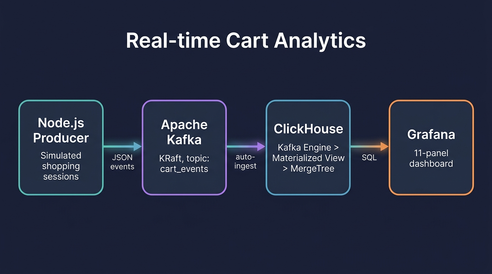
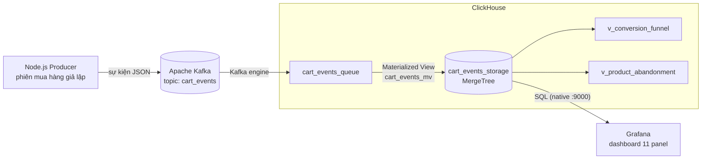
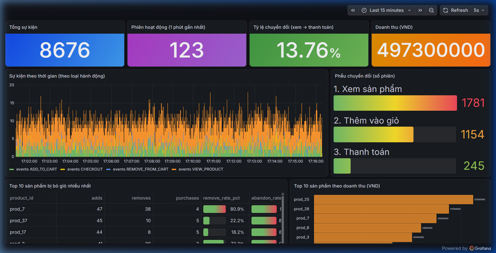
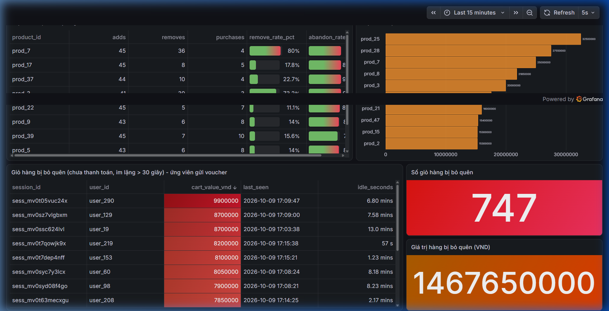

<div align="center">

# Real-time Cart Analytics

**Pipeline phân tích hành vi giỏ hàng thương mại điện tử theo thời gian thực.**
Node.js &rarr; Apache Kafka (KRaft) &rarr; ClickHouse &rarr; Grafana, chạy toàn bộ ở máy local chỉ với một lệnh.


[English](README.md) | [Tiếng Việt](README.vi.md)



</div>

---

## Mục lục

- [Tổng quan](#tổng-quan)
- [Dự án có gì](#dự-án-có-gì)
- [Kiến trúc](#kiến-trúc)
- [Chạy nhanh](#chạy-nhanh)
- [Dashboard](#dashboard)
- [Mô hình dữ liệu](#mô-hình-dữ-liệu)
- [Truy vấn phân tích](#truy-vấn-phân-tích)
- [Cách mô phỏng hoạt động](#cách-mô-phỏng-hoạt-động)
- [Cấu trúc thư mục](#cấu-trúc-thư-mục)
- [Quyết định thiết kế](#quyết-định-thiết-kế)
- [Vận hành](#vận-hành)
- [Giới hạn](#giới-hạn)
- [Lộ trình](#lộ-trình)
- [Giấy phép](#giấy-phép)

## Tổng quan

Cửa hàng online liên tục sinh ra các sự kiện giỏ hàng: xem sản phẩm, thêm vào giỏ, xóa khỏi giỏ, thanh toán. Phân tích luồng này **ngay khi nó đang diễn ra** giúp đội vận hành phát hiện thanh toán bị lỗi, sản phẩm định giá chưa hợp lý hoặc giỏ hàng giá trị cao bị bỏ quên chỉ trong vài giây, thay vì chờ đến sáng hôm sau.

Dự án này là một bản triển khai tham chiếu gọn, chạy lại được, cho ý tưởng đó. Phía ứng dụng (producer Node.js) tách biệt hoàn toàn với phía phân tích (ClickHouse). Kafka đóng vai trò bộ đệm bền vững ở giữa, nên lượng truy cập tăng đột biến trên web bán hàng không bao giờ đập thẳng vào cơ sở dữ liệu phân tích.

> **Lưu ý:** sự kiện do bộ giả lập sinh ra, không phải từ một cửa hàng thật. Các con số kinh doanh trên dashboard chỉ chứng minh pipeline hoạt động, không phải kết luận thực tế. Xem mục [Giới hạn](#giới-hạn).

## Dự án có gì

- **Bộ giả lập sự kiện theo phiên mua hàng** bằng Node.js (300 người dùng, phễu mua hàng thực tế, sản phẩm "có vấn đề").
- **Kafka chế độ KRaft** (không cần ZooKeeper), có listener nội bộ và bên ngoài tách biệt.
- **ClickHouse** tự hút dữ liệu từ Kafka (Kafka engine + Materialized View) và lưu vào bảng `MergeTree`.
- Hai **view SQL** phân tích (phễu chuyển đổi, bỏ giỏ theo sản phẩm) và bộ truy vấn chạy sẵn.
- **Dashboard Grafana 11 panel**, cấu hình bằng code: mở container lên là dùng được ngay.
- **Lưu trữ bền vững** bằng named volume, đã kiểm chứng bằng bài test restart.

## Kiến trúc



| Thành phần | Image | Cổng trên máy | Vai trò |
|---|---|---|---|
| Kafka | `apache/kafka:latest` | `9092` | Bộ đệm sự kiện bền vững, KRaft một node |
| ClickHouse | `clickhouse/clickhouse-server:latest` | `8123` (HTTP), `9000` (native) | Nạp, lưu trữ và phân tích |
| Grafana | `grafana/grafana:latest` | `3000` | Trực quan hóa |

Kafka mở hai listener để cả hai phía cùng kết nối được:

| Listener | Địa chỉ | Ai dùng |
|---|---|---|
| `INTERNAL` | `kafka:19092` | ClickHouse (trong mạng Docker) |
| `EXTERNAL` | `localhost:9092` | Producer Node.js (chạy trên máy host) |

## Chạy nhanh

**Yêu cầu:** Docker Desktop (Compose v2) và Node.js 18 trở lên. Khoảng 4 GB RAM trống là đủ.

```bash
# 1. Khởi động Kafka, ClickHouse và Grafana
docker compose up -d

# 2. Cài đặt và chạy producer
cd producer
npm install
node producer.js
```

Sau đó mở:

| Nội dung | Địa chỉ |
|---|---|
| Dashboard | http://localhost:3000 (xem ẩn danh, quản trị: `admin` / `admin`) |
| ClickHouse HTTP / DBeaver | `localhost:8123`, user `default`, mật khẩu trống |

Lần đầu cần tải khoảng 1 GB image. Producer in một dòng thống kê mỗi 5 giây:

```
[stats] phiên đang chạy: 13 | tổng sự kiện đã gửi: 1218
```

Kiểm tra nhanh từ terminal:

```bash
docker exec rca-clickhouse clickhouse-client --query \
  "SELECT action, count() AS total FROM cart_events_storage GROUP BY action ORDER BY total DESC"
```

## Dashboard

Tự động nạp từ [`grafana/dashboards/cart-analytics.json`](grafana/dashboards/cart-analytics.json), làm mới mỗi 5 giây.





| Panel | Trả lời câu hỏi |
|---|---|
| Tổng sự kiện | Dữ liệu có đang chảy không? |
| Phiên hoạt động (1 phút gần nhất) | Bao nhiêu người đang mua sắm ngay lúc này? |
| Tỷ lệ chuyển đổi (xem &rarr; thanh toán) | Bao nhiêu phần trăm phiên kết thúc bằng mua hàng? |
| Doanh thu (VND) | Bán được bao nhiêu trong khoảng thời gian chọn? |
| Sự kiện theo thời gian, theo loại hành động | Hình dạng lưu lượng và tỷ trọng từng hành động |
| Phễu chuyển đổi (số phiên) | Khách rời đi ở bước nào? |
| Top 10 sản phẩm bị bỏ giỏ | Sản phẩm nào được thêm nhưng ít được mua, bị xóa thường xuyên đến đâu? |
| Top 10 sản phẩm theo doanh thu | Sản phẩm nào bán chạy nhất? |
| Bảng giỏ hàng bị bỏ quên | Phiên nào còn hàng trong giỏ, chưa thanh toán và im lặng hơn 30 giây (ứng viên gửi voucher)? |
| Số giỏ / giá trị giỏ bị bỏ quên | Có bao nhiêu giỏ và bao nhiêu tiền đang nằm im? |

## Mô hình dữ liệu

Một bảng sự kiện duy nhất, mỗi sự kiện là một dòng:

| Cột | Kiểu | Mô tả |
|---|---|---|
| `session_id` | `String` | Một phiên mua sắm |
| `user_id` | `String` | Người mua (`user_0` ... `user_299`) |
| `action` | `String` | `VIEW_PRODUCT`, `ADD_TO_CART`, `REMOVE_FROM_CART`, `CHECKOUT` |
| `product_id` | `String` | `prod_0` ... `prod_49` |
| `quantity` | `UInt16` | Số lượng trong sự kiện |
| `price` | `UInt32` | Đơn giá (VND) |
| `timestamp` | `DateTime` | Thời điểm sự kiện, giờ **UTC** |

Chuỗi nạp dữ liệu được định nghĩa trong [`clickhouse/init.sql`](clickhouse/init.sql):

```
cart_events_queue (Kafka engine)  --cart_events_mv-->  cart_events_storage (MergeTree)
```

ClickHouse đọc Kafka theo lô nên số liệu tăng từng bước nhỏ (khoảng 7,5 giây một lần), không phải từng sự kiện. Đây là hành vi bình thường.

## Truy vấn phân tích

Các truy vấn viết sẵn nằm trong [`clickhouse/analytics.sql`](clickhouse/analytics.sql). Hai trong số đó được đóng gói thành view:

```sql
-- Phễu: số phiên ở mỗi bước và tỷ lệ chuyển đổi giữa các bước
SELECT * FROM v_conversion_funnel FORMAT Vertical;

-- Sản phẩm được thêm vào giỏ nhưng không được mua
SELECT product_id, adds, removes, purchases, remove_rate_pct, abandon_rate_pct
FROM v_product_abandonment
WHERE adds >= 5
ORDER BY (adds - purchases) DESC
LIMIT 10;
```

Kết quả ví dụ từ một lần chạy ngắn ở máy local:

| viewed | added_to_cart | checked_out | view_to_cart_pct | cart_to_checkout_pct | view_to_checkout_pct |
|---|---|---|---|---|---|
| 152 | 92 | 24 | 60.53 | 26.09 | 15.79 |

## Cách mô phỏng hoạt động

[`producer/producer.js`](producer/producer.js) chạy đồng thời nhiều phiên mua hàng, khoảng hai phiên mới mỗi giây.

```
phiên:  xem 1-6 sản phẩm
          └─ 30% lượt xem → ADD_TO_CART (1-3 sản phẩm)
               └─ 15% → REMOVE_FROM_CART   (70% với sản phẩm "có vấn đề")
        cuối phiên: 25% phiên còn hàng trong giỏ → CHECKOUT
```

Năm sản phẩm đắt (`prod_3`, `prod_7`, `prod_12`, `prod_25`, `prod_41`, giá 2.500.000 VND) bị xóa khỏi giỏ nhiều hơn hẳn phần còn lại. Đây là quy luật được cài sẵn để bạn kiểm tra phần phân tích có phát hiện ra hay không. Các hằng số điều chỉnh nằm ở đầu file (`USER_POOL`, `MAX_SESSIONS`, `P_CHECKOUT`, ...).

## Cấu trúc thư mục

```
realtime-cart-analytics/
├── docker-compose.yml            # Kafka + ClickHouse + Grafana, named volume
├── producer/
│   ├── producer.js               # bộ giả lập sự kiện theo phiên (kafkajs)
│   └── package.json
├── clickhouse/
│   ├── init.sql                  # bảng, materialized view, view phân tích (tự chạy)
│   └── analytics.sql             # truy vấn phân tích chạy sẵn
├── grafana/
│   ├── provisioning/             # datasource + dashboard provider (dạng code)
│   └── dashboards/
│       └── cart-analytics.json   # dashboard 11 panel
├── docs/images/                  # sơ đồ kiến trúc và ảnh chụp màn hình
├── LICENSE
└── README.md
```

## Quyết định thiết kế

| Quyết định | Lý do |
|---|---|
| Kafka chế độ **KRaft** | Bỏ ZooKeeper, tiết kiệm RAM và bớt một thành phần khi chạy local |
| `apache/kafka` thay cho `bitnami/kafka` | Image chính thức; tag `latest` của Bitnami không còn pull ổn định |
| **Hai listener Kafka** | Chỉ advertise `kafka:9092` thì producer chạy trên máy host không kết nối được |
| `date_time_input_format = 'best_effort'` | Để ClickHouse đọc được timestamp ISO-8601 có hậu tố `Z` |
| SQL nằm trong `init.sql`, mount vào container | Schema tạo tự động, tái lập được, không cần thao tác tay trong DBeaver |
| Cố định `CLUSTER_ID` và thư mục log của Kafka | Broker khởi động lại phải nhận đúng volume dữ liệu cũ |
| Grafana provisioning dạng code | Dashboard và datasource có sẵn ngay khi clone, không cần bấm chuột |
| Named volume cho Kafka và ClickHouse | Dữ liệu còn nguyên sau `docker compose down` |

## Vận hành

```bash
docker compose ps                      # tình trạng container
docker compose logs -f kafka           # xem log một service
docker compose down                    # dừng, GIỮ dữ liệu
docker compose down -v                 # dừng và XÓA toàn bộ dữ liệu
```

**Kiểm tra sức khỏe pipeline**

```bash
# Consumer lag nên luôn gần 0
docker exec rca-kafka /opt/kafka/bin/kafka-consumer-groups.sh \
  --bootstrap-server localhost:19092 --describe --group clickhouse_consumer_group

# Số dòng phải tăng dần
docker exec rca-clickhouse clickhouse-client --query "SELECT count() FROM cart_events_storage"
```

**Bài test lưu trữ bền vững (đã kiểm chứng):** khi có 1.237 sự kiện, chạy `docker compose down` rồi `up -d` thì ClickHouse vẫn còn 1.237 sự kiện và Kafka consumer lag bằng 0.

> Nếu đổi schema trong `init.sql`, hãy chạy `docker compose down -v` trước. Script init chỉ chạy khi ClickHouse khởi tạo thư mục dữ liệu trống.

## Giới hạn

- **Dữ liệu giả lập.** Tỷ lệ chuyển đổi, doanh thu và "sản phẩm có vấn đề" đến từ tham số của bộ giả lập, không phải khách hàng thật.
- **Một node.** Một broker Kafka và một server ClickHouse, replication factor 1: không có tính sẵn sàng cao.
- **Chưa được gia cố bảo mật.** Grafana cho xem ẩn danh và dùng `admin` / `admin`; Kafka và ClickHouse không có xác thực hay TLS. Chỉ dùng ở máy local.
- **Giá trị giỏ bị bỏ quên là ước tính.** Giá trị được tính từ sự kiện thêm và xóa; cùng một sản phẩm thêm hai lần trong một phiên có thể làm lệch nhẹ.
- Bảng giỏ hàng bị bỏ quên chỉ để xem; chưa có gì tự động gửi voucher hay email.

## Lộ trình

- [ ] Cảnh báo khi tỷ lệ thanh toán tụt mạnh
- [ ] Thay bộ giả lập bằng một HTTP API nhỏ để client thật gửi sự kiện vào
- [ ] Bảng tổng hợp sẵn bằng `AggregatingMergeTree` để dashboard nhanh hơn khi dữ liệu lớn
- [ ] Xác thực và TLS cho Kafka, ClickHouse và Grafana
- [ ] Test tự động cho bộ giả lập và các view SQL

## Giấy phép

Phát hành theo [Giấy phép MIT](LICENSE).
